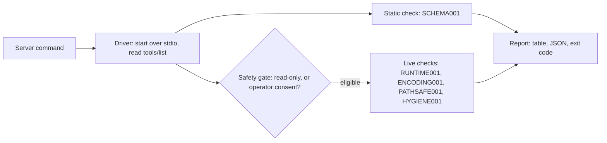

# mcp-audit

[](https://github.com/Alpha-W0lf/mcp-audit/actions/workflows/ci.yml)


**Conformance tests for MCP servers.** Point mcp-audit at any stdio
[MCP](https://modelcontextprotocol.io) server. It reads the contract every tool
advertises, then calls the tools to prove the code keeps that contract.

## Proof: two real bugs in the official servers

mcp-audit flagged two known bugs
([#4651](https://github.com/modelcontextprotocol/servers/issues/4651),
[#4686](https://github.com/modelcontextprotocol/servers/issues/4686)) in the
official MCP servers before their fixes shipped. Other people filed both
issues. The runs that flagged them were recorded on 2026-08-25 and
2026-08-26, before either fix merged:

- **`sequentialthinking`:** the schema left `nextThoughtNeeded` out of
  `required`, but the server rejected any call without it (#4651).
  RUNTIME001: **flagged**.
- **`filesystem`:** on a POSIX system, `write_file` accepted
  `C:\mcp-audit-probe.txt` and created a file with that literal name (#4686).
  PATHSAFE001: **flagged**.
- **Upstream fix:** on #4651, I traced the root cause and compared the three
  open fix PRs. I recommended
  [#4652](https://github.com/modelcontextprotocol/servers/pull/4652), and that
  is the fix that merged
  ([analysis](https://github.com/modelcontextprotocol/servers/issues/4651#issuecomment-5413590077)).

The dated run records and reproduction steps are in
[docs/REAL_SERVER_RESULTS.md](docs/REAL_SERVER_RESULTS.md).

## The problem

An MCP server describes its tools in one place and checks their inputs in
another. When the two drift apart, AI clients that trust the advertised
schema break, files get corrupted, and private paths leak. Bugs like these
have reached the official MCP reference servers, and a schema linter cannot
see them, because the schema itself looks fine.

## How it works



Each check is a small async function registered under a stable ID, so CI
pipelines can skip one by name. The code is split into one module per job:
`driver.py` runs the server and the tool calls, `safety.py` decides which
tools may be called, `registry.py` registers checks, `models.py` owns the
report and exit codes, and `checks/` holds one module per check, with its
spec in the docstring.

### The five checks

| ID | What it catches | Source |
|---|---|---|
| `SCHEMA001` | A broken advertised schema: a `required` field missing from `properties`, or an invalid type. Static; it calls no tools. | Written while investigating [#4651](https://github.com/modelcontextprotocol/servers/issues/4651) |
| `RUNTIME001` | Drift between the advertised `required` list and what the server enforces. It leaves out each required field in turn and reads the response. Runtime stricter than advertised is an error (the #4651 bug); schema stricter than runtime is a warning. | [#4651](https://github.com/modelcontextprotocol/servers/issues/4651) |
| `ENCODING001` | File readers that split UTF-8 characters at 1024-byte chunk edges. It places a 3-byte character exactly on each edge and reads it back, using the tool's head or count limit when it has one. | [#4666](https://github.com/modelcontextprotocol/servers/issues/4666) |
| `PATHSAFE001` | A Windows path such as `C:\file.txt` accepted on macOS or Linux and saved as a literal file name. A write probe, so it needs `--allow-destructive`. | [#4686](https://github.com/modelcontextprotocol/servers/issues/4686) |
| `HYGIENE001` | Tool output that leaks home-directory or server-root paths (`/Users/<name>/`, `C:\Users\<name>\`, `/srv/`). | Common leak class: home or server-root paths in tool output |

## Key engineering decisions

1. **Probe the runtime, not just the schema.** The #4651 schema was valid
   JSON Schema; only calling the tool exposed the drift. RUNTIME001 leaves
   out each required field in turn and reads the server's answer, so it
   catches drift in both directions and grades the direction that breaks
   clients as an error.
2. **A fail-closed safety gate.** Live probes call only tools that declare
   `readOnlyHint=true`. `--allow-tool NAME` opens one tool and
   `--allow-destructive` opens all of them; the write probe needs the second.
   Test files get unpredictable names, mcp-audit never creates directories,
   and reports mask user names in any leaked path. The full list is in
   [SECURITY.md](SECURITY.md).
3. **Every live check proven against a real buggy server.** The bundled
   fixture server runs as a real process, with deliberately buggy tools and
   correct twins. CI asserts that each live check fails its buggy tool, and
   unit tests cover every pass and skip path: 137
   tests, lint and type checks on Python 3.11 and 3.12, on every PR and
   every push to `main`.

## Try it

```console
$ git clone https://github.com/Alpha-W0lf/mcp-audit && cd mcp-audit
$ python -m venv .venv && . .venv/bin/activate && pip install -e .
$ mcp-audit run --server "python tests/fixtures/fixture_server.py"
```

The bundled fixture server has a broken tool for each live check. The run
exits with code 1 and reports these failures (abridged: the status column,
passes and skips are left out, and long messages are cut with `…`):

```text
check        sev      tool            message
ENCODING001  error    mojibake_read   mojibake_read: corrupt UTF-8 at chunk boundary — 3 U+FFFD replacement character(s) …
ENCODING001  error    read_head       read_head: corrupt UTF-8 at chunk boundary — 1 U+FFFD replacement character(s) …
ENCODING001  error    read_text_head  read_text_head: corrupt UTF-8 at chunk boundary — 1 U+FFFD replacement character(s) …
HYGIENE001   error    cite_doc        cite_doc: response leaks absolute owner filesystem path (posix_home_path; e.g. /Users/<redacted>/…) …
RUNTIME001   error    hidden_beta     omit 'alpha': runtime rejected undeclared-required field 'beta' — runtime stricter than advertised
RUNTIME001   warning  loose_required  omit 'must_have': accepted — schema stricter than runtime
RUNTIME001   warning  mojibake_read   omit 'path': accepted — schema stricter than runtime
40 checks · 19 pass · 7 fail (error:5, warning:2) · 14 skip
```

The correct twins (`strict_echo`, `read_head_safe`, `cite_doc_safe`) pass.
Add `--allow-destructive` to run the write probe too; it flags
`drive_letter_create` for accepting a Windows path on POSIX.

Audit your own server:

```console
$ mcp-audit run --server "node dist/index.js" --json report.json
$ mcp-audit run --server "node dist/index.js" [--arg ARG]... [--skip ID]...
      [--only ID]... [--allow-destructive | --allow-tool NAME]... [--strict]
      [--json PATH] [--startup-timeout SECONDS] [--call-timeout SECONDS]
```

| Flag | What it does |
|---|---|
| `--arg` | Appends an argument to the server command. It also tells mcp-audit the server's allowed directories, where it places test files and checks for stray ones. |
| `--skip` / `--only` | Leaves out a check, or runs only the named checks, by ID. |
| `--strict` | Makes failed warnings fail the run too. |
| `--json PATH` | Writes a machine-readable report, even when the server fails to start. |

| Exit code | Meaning |
|---|---|
| `0` | Every result passed or was skipped. Failed warnings pass unless you use `--strict`. |
| `1` | A failed error-level check, any failure under `--strict`, a server that would not start, or a crash while shutting down. |
| `2` | A usage error, such as bad flags or an unknown check ID. |
| `130` | The run was interrupted (Ctrl-C). |

Library use:

```python
import asyncio
from mcp_audit.cli import run_checks

report = asyncio.run(run_checks(["node", "dist/index.js"]))
print(report.summary, report.exit_code)
```

## Stack

Python 3.11+, the official MCP Python SDK (2.x) over stdio, Rich for the
report table, pytest with real subprocess servers, ruff, mypy, and GitHub
Actions with SHA-pinned actions.

## Deeper docs

- [docs/REAL_SERVER_RESULTS.md](docs/REAL_SERVER_RESULTS.md): dated runs
  against the official MCP servers, with reproduction steps.
- [docs/OPERATOR.md](docs/OPERATOR.md): CI recipes and sandbox setups.
- [SECURITY.md](SECURITY.md): what a run can touch, and how to report a
  vulnerability.
- [CONTRIBUTING.md](CONTRIBUTING.md): development setup and the test and
  lint commands.
- [AGENTS.md](AGENTS.md): instructions for coding agents.
- [CHANGELOG.md](CHANGELOG.md): release history.

Built by Thomas (Tom) Chacko, Senior AI Engineer (Ex-Meta), with coding agents
working under written quality gates: every change ships with tests, lint and
type checks in CI.

## License

MIT. See [LICENSE](LICENSE).
